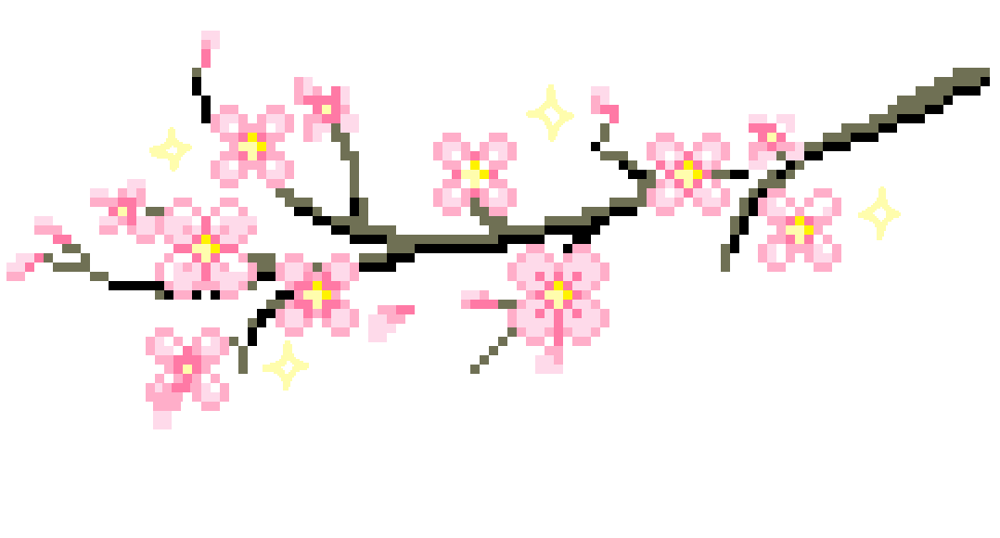

  

# Hi, I'm Katerina 🌸

MSc student in Games Technology at ITU Copenhagen, exploring playful, game-feel interfaces on the web.
I like building things with code and figuring out how they work (and why they break).

[LinkedIn](https://www.linkedin.com/in/katerina-georgiadou-239089200?utm_source=share&utm_campaign=share_via&utm_content=profile&utm_medium=ios_app)

## What I'm building here
- 🎨 Creative front-end projects with interesting interfaces
- 🧪 Experiments I'm trying out for the first time
- 🎮 Game prototypes and playful web experiments

## Tools I work with

---

*Currently learning and getting better one commit at a time ✨*
